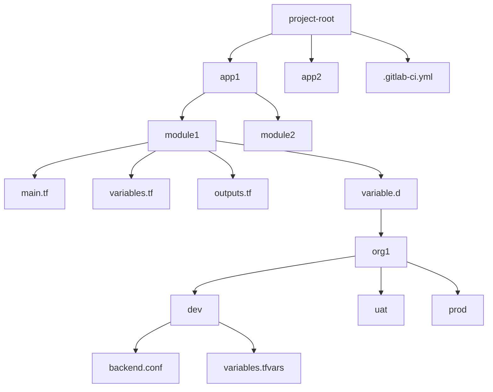

# Infrastructure & Environment as Code Guidelines
CoreCI-IaC-EaC is a comprehensive GitLab CI/CD framework designed for managing and deploying infrastructure using Infrastructure as Code (IaC) principles. It provides automated workflows for both dynamic and tag-based deployments with built-in security features.
## Table of Contents
1. [Folder Structure](#folder-structure)
2. [Pipeline Architecture](#pipeline-architecture)
3. [Naming Conventions](#naming-conventions)

## Folder Structure
```text
CoreCI-IaC-EaC/
├── core-ci/                      # Core CI templates và configurations
│   ├── .gitlab-ci.yml           # CI configuration chính
│   └── templates/               # Templates cho CI/CD
│       ├── base/               # Các template cơ bản
│       │   ├── cache.yml      # Cache configurations
│       │   ├── common.yml     # Common configurations và jobs
│       │   ├── stages.yml     # Stage definitions
│       │   └── variables.yml  # Global variables
│       ├── jobs/              # Job templates
│       │   ├── cleanup/      # Cleanup jobs
│       │   ├── deploy/       # Deploy jobs
│       │   ├── init/         # Initialization jobs
│       │   ├── notify/       # Notification jobs
│       │   └── plan/        # Planning jobs
│       └── workflows/        # Workflow templates
│           ├── dynamic.yml   # Dynamic workflow
│           └── tag-deploy.yml # Tag-based deployment workflow
└── eac/                       # Environment as Code
    └── .gitlab-ci.yml        # EaC specific CI configuration
```
### Stage Flow

## Pipeline Architecture
### Stages
The pipeline consists of the following stages:
- `.pre`: Initialization and setup
- `init`: Resource preparation
- `validate`: Validation and testing
- `security`: Security checks
- `plan`: Terraform planning
- `deploy`: Deployment (manual by default)
- `notify`: Notification handling
- `cleanup`: Resource cleanup

### Jobs
The pipeline consists of the following jobs: 
- `detect_changes`: Identifies changed modules/paths
- `generate_dynamic_jobs`: Creates jobs based on changes
- `trigger_dynamic`: Triggers dynamic child pipeline
- `extract_tag_vars`: Processes deployment tags
- `plan`: Terraform plan job
- `deploy`: Terraform apply job
- `notify`: Sends notifications
- `cleanup_tag`: Cleans up deployment tags

## Naming Conventions
### Job Naming
- `{APP}_{MODULE}_{ORG}_{ENV}_{JOB_NAME}`
- `{APP}`: Application name
- `{MODULE}`: Module name
- `{ORG}`: Organization name
- `{ENV}`: Environment name
- `{JOB_NAME}`: Job name

### Tag Naming
- `deploy_{APP}_{MODULE}_{ORG}_{ENV}`
- `{APP}`: Application name
- `{MODULE}`: Module name
- `{ORG}`: Organization name
- `{ENV}`: Environment name